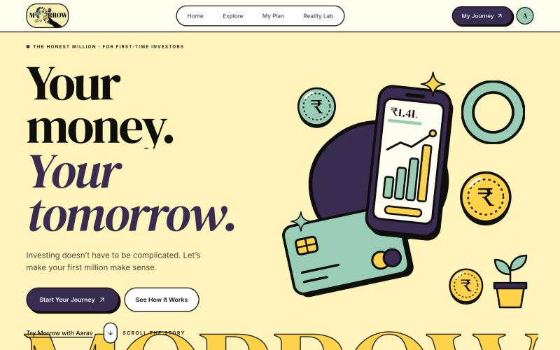
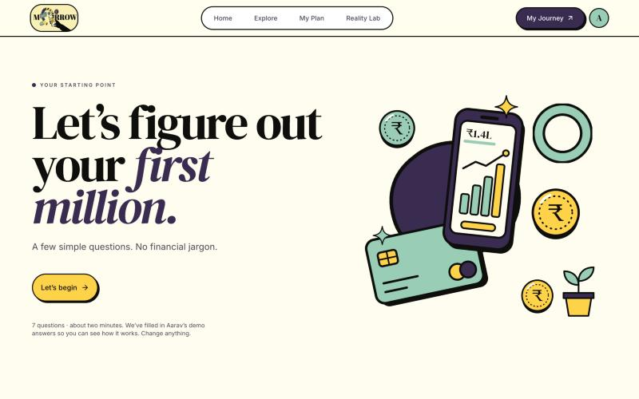
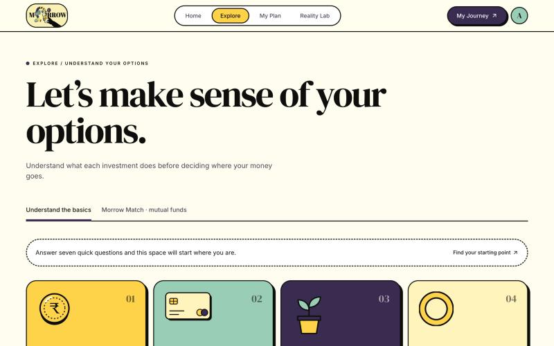
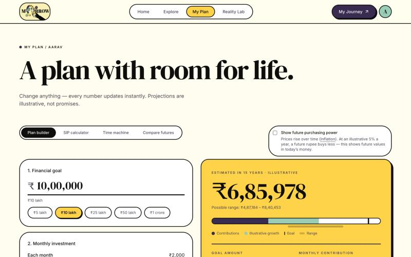
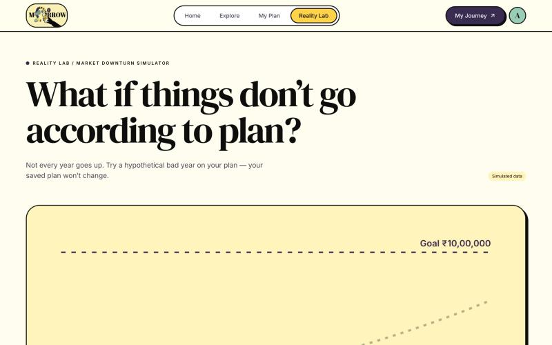
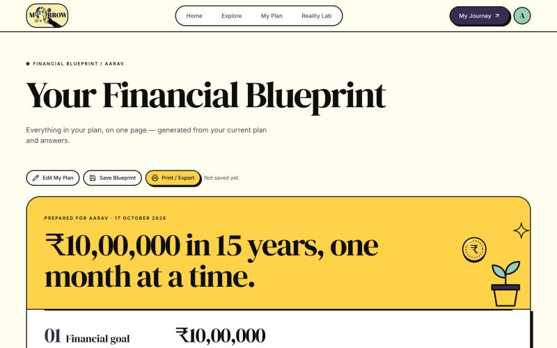

<p align="center">
  
</p>

<h1 align="center">Morrow</h1>

<p align="center"><strong>Your money. Your tomorrow.</strong><br/>
A friendly, jargon-free space for first-time investors in India to understand their options, plan toward their first million and see what happens when markets don't cooperate.</p>

<p align="center">
  <a href="https://artemis-ten-theta.vercel.app"><strong>🌐 Live demo → artemis-ten-theta.vercel.app</strong></a>
</p>

---

## Why Morrow?

Too many options, too much jargon, and too many "get rich quick" promises. Morrow takes a first-time investor from *"where do I even start?"* to a one-page financial blueprint: no stock tips, no overnight riches, just honest, illustrative maths.

> ⚠️ Morrow is an educational tool. All projections are illustrative, not promises, and nothing here is financial advice.

## Features

| | |
| --- | --- |
| **Guided onboarding** | Seven quick questions (about two minutes) set your goal, income, expenses, horizon and comfort with risk. It's pre-filled with a demo persona, Aarav, so you can explore straight away. |
| **Explore** | Plain-language cards explain what each type of investment does, with a compare tray to view them side by side. |
| **Morrow Match** | Simple, transparent rules pick up to three mutual fund categories worth *learning about*, based on your goal, timeline and monthly budget. |
| **My Plan** | A plan builder where every number updates instantly, plus an SIP calculator, a "time machine" and a side-by-side comparison of possible futures. An optional toggle shows future purchasing power after inflation. |
| **Reality Lab** | A market downturn simulator. Try a hypothetical bad year on your plan without changing your saved plan. |
| **Financial Blueprint** | Your whole plan on one printable page, generated from your answers. You can save it or print/export it. |
| **Built-in glossary** | Financial terms are explained inline wherever they appear. |
| **Accessible by default** | Keyboard-friendly navigation, accessible sliders and sheets, and support for reduced-motion preferences. |

## Screenshots

| Landing | Onboarding |
| --- | --- |
|  |  |
| **Explore** | **My Plan** |
|  |  |
| **Reality Lab** | **Financial Blueprint** |
|  |  |

## Tech stack

| Area | Tools |
| --- | --- |
| **Framework** | [React 19](https://react.dev) + [TypeScript 5.9](https://www.typescriptlang.org) |
| **Build tool** | [Vite 7](https://vite.dev) |
| **Routing** | [React Router 7](https://reactrouter.com), using hash routing so static hosting needs no rewrites |
| **Styling** | [Tailwind CSS v4](https://tailwindcss.com), `tw-animate-css` |
| **UI primitives** | [Radix UI](https://www.radix-ui.com) set up shadcn/ui-style (`class-variance-authority`, `clsx`, `tailwind-merge`) |
| **Icons** | [Lucide](https://lucide.dev) |
| **Animation** | [Motion](https://motion.dev) for UI transitions, [GSAP](https://gsap.com) for scroll storytelling, [Lenis](https://lenis.darkroom.engineering) for smooth scrolling |
| **Charts** | [Recharts](https://recharts.org) |
| **State** | [Zustand](https://zustand.docs.pmnd.rs), persisted to `localStorage` with safe fallbacks |
| **Fonts** | DM Serif Display, Instrument Serif and Inter, self-hosted via Fontsource |
| **Testing** | [Vitest](https://vitest.dev), React Testing Library, jsdom |
| **Hosting** | [Vercel](https://vercel.com) |

Morrow is **frontend-only**. There is no backend, login or real money movement. Your data stays in your browser.

## Getting started

Requires **Node.js 22.12+**.

```bash
git clone https://github.com/rehaniranii/Artemis.git
cd Artemis
npm ci
npm run dev
```

Then open the local URL Vite prints (usually http://127.0.0.1:5173).

| Script | What it does |
| --- | --- |
| `npm run dev` | Start the dev server |
| `npm run build` | Type-check and build for production into `dist/` |
| `npm run preview` | Serve the production build locally |
| `npm run typecheck` | Run the TypeScript compiler only |
| `npm test` | Run the Vitest test suite |

## Project structure

```
src/
├── pages/            Route entry points (lazy-loaded)
├── features/         Feature modules: onboarding, explorer, match, plan, reality, story, dashboard
├── components/
│   ├── ui/           Radix-based primitives (button, input, sheet, slider…)
│   ├── layout/       App shell, navbar, error boundary
│   ├── shared/       Page headers, empty states, disclaimers, glossary terms
│   ├── financial/    Progress ring, investment slider and other money widgets
│   ├── charts/       Recharts wrappers
│   └── illustrations/
├── store/            Zustand store: single source of truth, validated and persisted
├── lib/calculations/ Pure financial maths (SIP / future value), fully unit-tested
├── data/             Investment concepts, funds, assumptions, glossary, demo persona
├── hooks/            Derived financial summary, motion preferences
└── styles/           Tailwind tokens and typography
```

## Routes

| Path | Page |
| --- | --- |
| `/#/` | Landing |
| `/#/onboarding` | Guided onboarding |
| `/#/home` | Your dashboard |
| `/#/explore` | Explore investment options |
| `/#/explore/match` | Morrow Match |
| `/#/explore/funds/:fundId` | Fund detail |
| `/#/plan` | My Plan (builder, SIP calculator, time machine, compare futures) |
| `/#/reality-lab` | Reality Lab downturn simulator |
| `/#/blueprint` | Financial Blueprint |
| `/#/design-system` | Component library |

## Disclaimer

Morrow is built for financial education. Fund data, returns and scenarios are **illustrative or simulated**, and they don't predict real market performance. Nothing in this app is investment advice. Talk to a registered financial adviser before making investment decisions.
